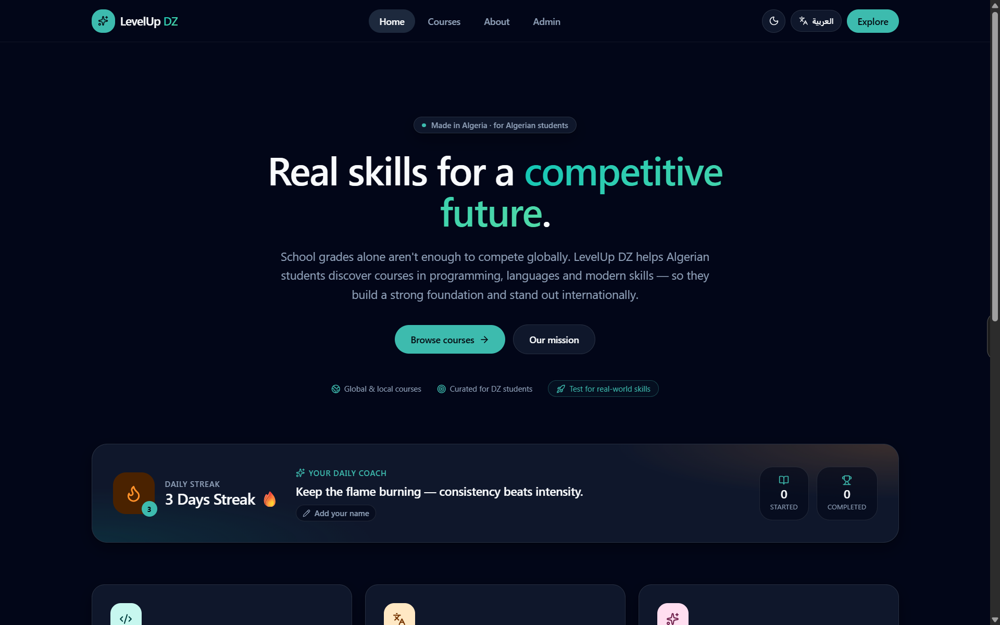

# 🚀 LevelUp DZ

> **Real skills for a competitive future.**

**LevelUp DZ** is a curated directory of high-quality online courses built for Algerian students.

Many students graduate with good grades but still struggle to compete internationally because they lack practical skills that are rarely taught in school or university. This project helps bridge that gap by collecting trusted learning resources in one place.

---

## 🌍 Why this project?

The Algerian education system provides important academic foundations, but academic success alone is no longer enough.

Today's opportunities require practical skills in programming, artificial intelligence, languages, business, communication, and many other fields.

Finding the right course is difficult.

Thousands of courses exist online, but beginners often waste weeks searching without knowing which ones are actually worth studying.

**LevelUp DZ** solves this problem by providing a carefully selected collection of useful courses for Algerian students.

---

## ✨ Features

* 📚 Carefully selected online courses
* 💻 Programming & Technology
* 🤖 Artificial Intelligence & Modern Skills
* 🌍 Languages
* 🔥 Daily learning streak tracker for consistency
* 🌙 Light & Dark mode
* 🌐 Arabic & English interface
* 📱 Mobile-friendly design
* 💡 Community feedback section for future improvements

---

## 📂 Course Collection

The platform currently includes **36 manually selected courses**.

Every course was researched, reviewed, and added manually to ensure quality instead of simply importing random content.

The goal is quality over quantity.

---

## 🎯 Target Audience

This project is built for:

* Algerian high school students
* University students
* Self-learners
* Anyone who wants practical skills beyond traditional education

---

## 🖥️ Live Website

Try the platform here:

**🔗 [LevelUp DZ](https://oussama-group-levelup-dz.lovable.app/)**

---

## 📸 Preview

---

## 💡 Vision

This is only the beginning.

Future versions may include:

* User accounts
* Progress synchronization
* Personalized course recommendations
* Achievement badges
* More learning categories
* Better search and filtering

---

## 🛠️ Technologies

* Lovable
* React
* TypeScript
* Tailwind CSS

---

## 👨‍💻 Developer

**Oussama**

Built through self-learning and continuous practice.

---

> **School gives students grades. Skills build careers. LevelUp DZ helps Algerian students discover the skills that school often doesn't teach.**
*Made with 💻, 📊 (Custom CSV), and 🎯 in Algeria for Algerian students.*

---

## AI Assistance

This project was developed with AI-assisted tools.

I designed the idea, selected and organized the course dataset, defined the platform structure and user experience, and iterated on the product design. Lovable was used to accelerate the implementation of the web interface based on my specifications.

The educational content, course selection, and overall product vision are my own.

---

## 👨‍💻 Developer

**Oussama**  
Algeria

Designed and curated to help Algerian students discover practical skills beyond traditional education.
